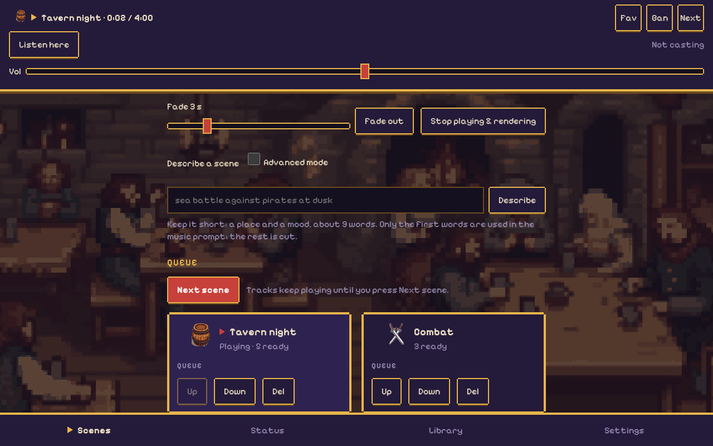
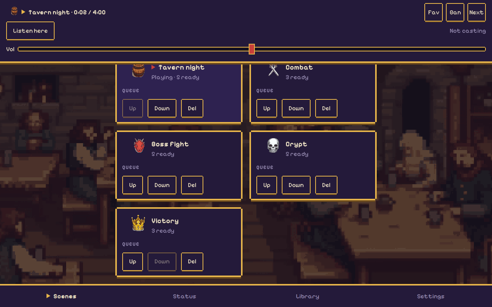
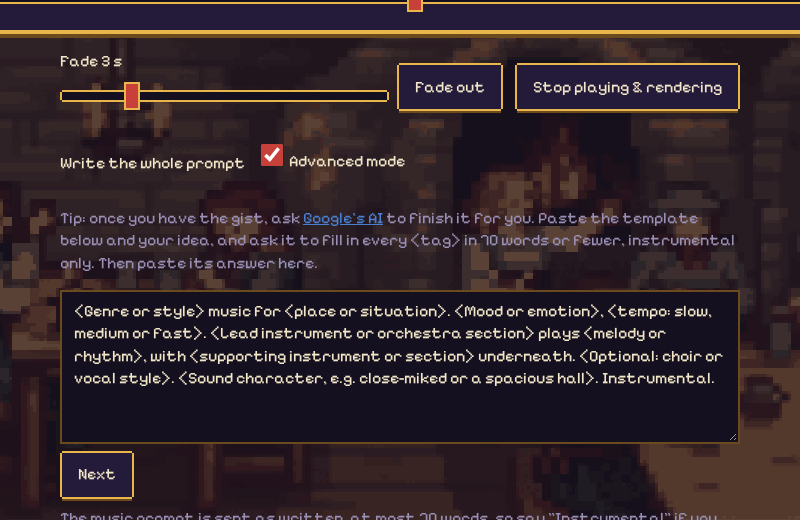
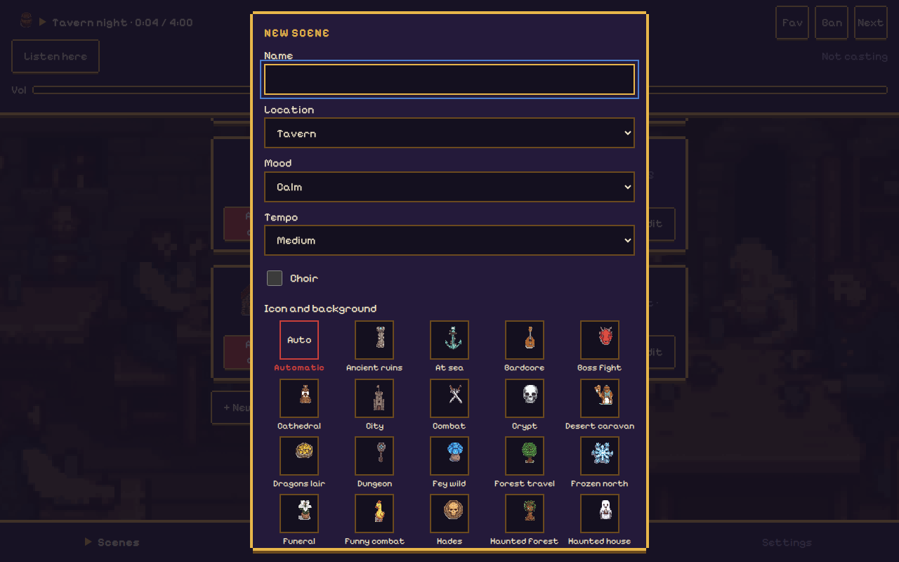
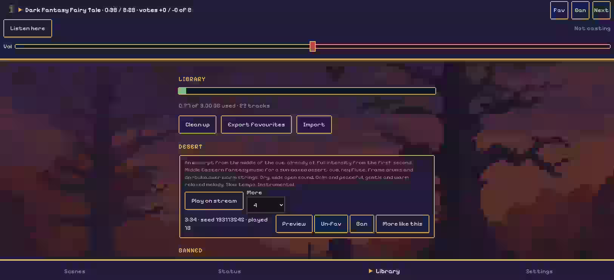
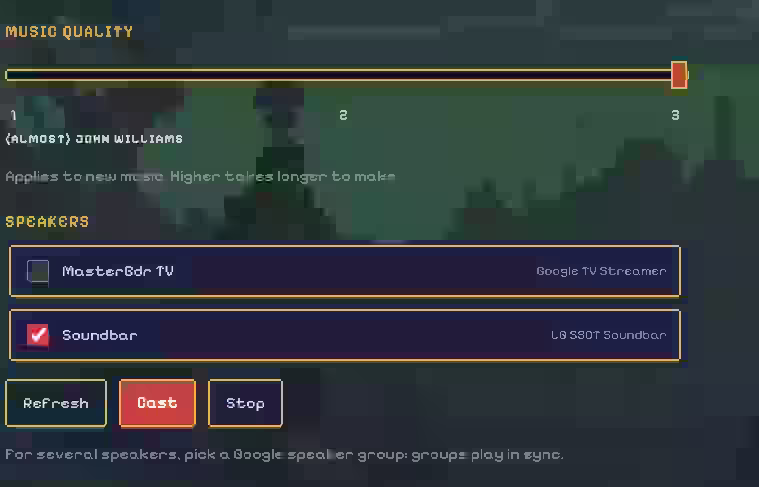
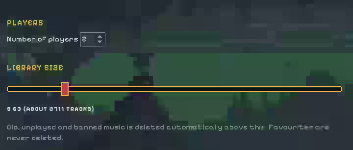
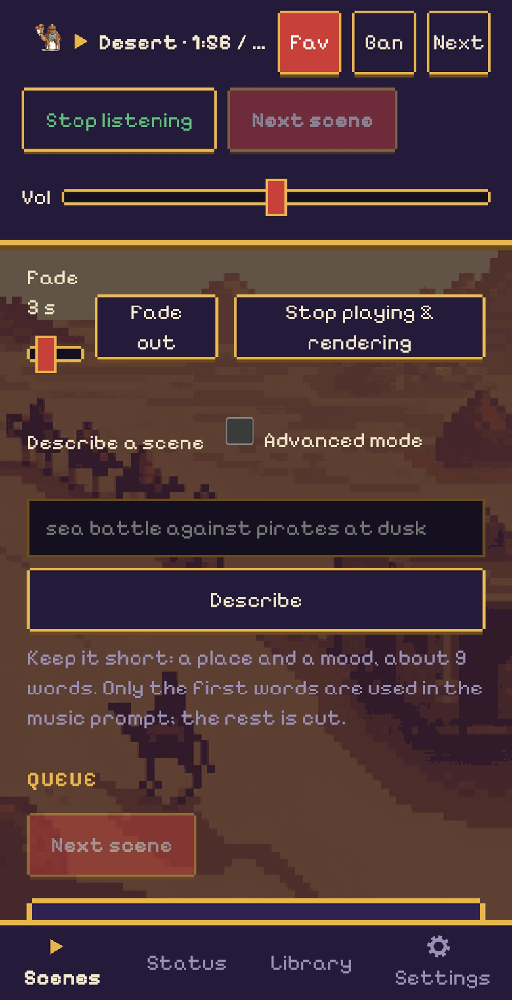
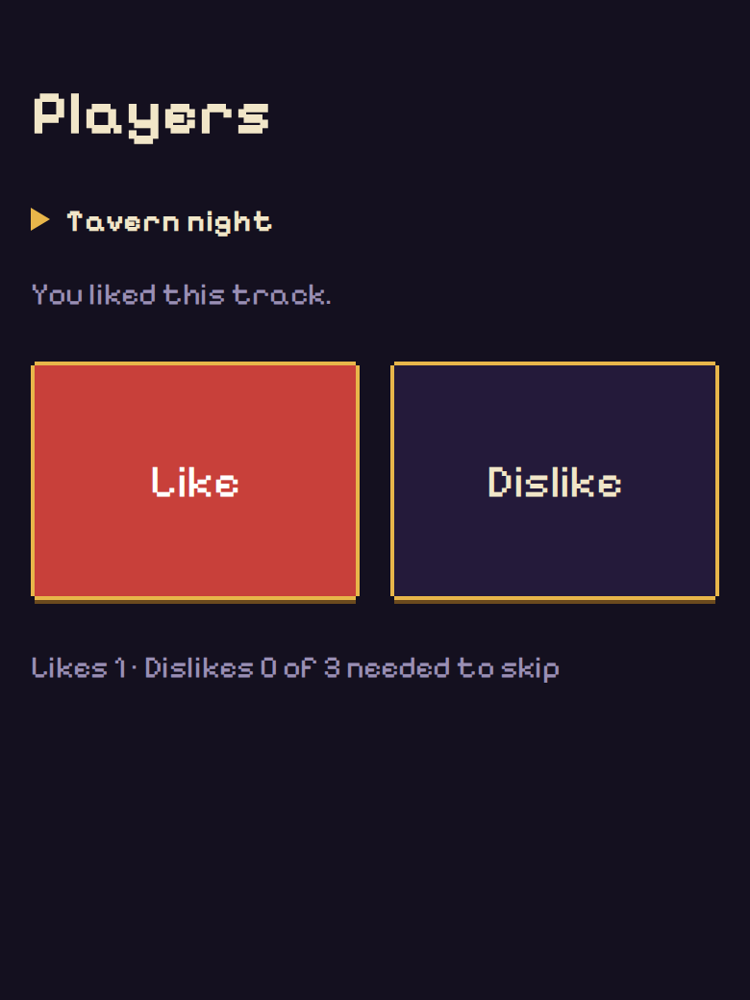
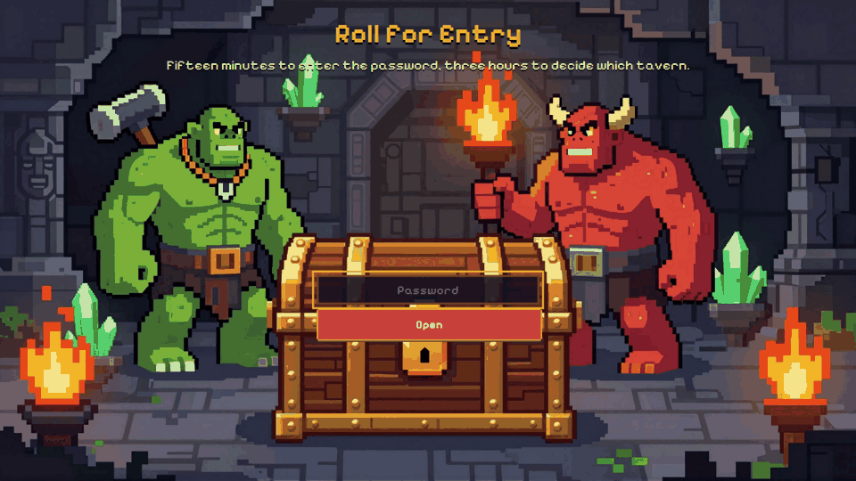

# dnd-music-creator

**You don't need a theatre voice to run a great game.**

The best tables you've watched online have a secret: the sound. You can't do twelve voices and a dragon's roar, but you can make the room *feel* like a crypt, a storm or a boss fight, and the players will believe it. Type a few words, press one button, and the music turns the mood on cue while you keep telling the story. Original instrumental tracks, no playlist digging, no lyrics talking over you, running from your phone. Your voice stays yours; the atmosphere is on us.

Background music for your D&D table that you steer from your phone. You describe a scene (say *"Ambush on the road: forest road, combat, fast, choir"*), queue it and press **Next scene**, and the music crossfades to match. It plays on your Chromecast or Google speakers, or any media player on your network.

It was designed with Dungeons & Dragons in mind, but nothing in it is specific to that game: any tabletop role-playing game, board game or storytelling session can use it. Scenes are just a place, a mood and a tempo, and you can write your own.

> **Status:** milestones 1 to 6 and 8 of 8 done. See the [roadmap](docs/roadmap.md). Powered by Stability AI.

## Why use it at the table

Music is a second narrator. It tells the players how to feel without you saying a word.

- **Set the mood without announcing it.** A calm tavern theme that turns into low, tense music says "something is wrong here" before you open your mouth. Stop narrating *"you feel uneasy"*; let the table feel it.
- **Change it mid-sentence.** One tap on **Next scene** crossfades the music while you keep talking and keep eye contact. No pausing to find a song, no broken moment.
- **Use silence on purpose.** **Fade out** drops the music to nothing before a reveal or a big roll. The sudden quiet makes everyone lean in.
- **It fits your story.** Describe *"burning village at dusk"* and it renders a track for that, instead of the nearest playlist match. The music is instrumental, so it never competes with you or the players.
- **Prep once, run it on autopilot.** Queue the scenes you expect before game night, then just press **Next scene** as the evening unfolds. The queue doubles as a pacing plan.

## Features



- **Scenes you steer from your phone.** A scene is a place, a mood, a tempo and an optional choir. 19 starter scenes come with music, so it plays from the first minute; the generator then fills the library in the background.
- **Queue and Next scene.** Queue scenes, press **Next scene** and the music crossfades. On a phone there is a **Next scene** button in the top bar beside **Listen here**, so you can move on from any tab. On a computer, drag queued scenes to reorder them; **Up**, **Down** and **Del** work everywhere.
- **Describe a scene in your own words.** Type *"sea battle against pirates at dusk"* and it becomes a scene, with the same checks the built-in ones get.
- **Advanced mode.** Tick it to write the whole music prompt yourself, from a template with `<tags>` to fill in (up to 70 words).
- **Pick an icon and background.** Any scene can use one of 32 icon and background sets (taverns, crypts, swamps, dragon's lairs, Hades and more). Desktop gets 1920x1080 pixel art, phones a lighter set.
- **Retro 16-bit look.** The page background follows the playing scene and changes on every track.
- **Quality slider.** From *Primary school guitar lesson* to *(almost) John Williams*: better music takes longer to render.
- **Play it anywhere.** Listen in the browser or cast to Google speakers and groups.
- **Favourites, bans and a size limit.** Keep the tracks you love, ban the ones you don't, export and import favourites; the oldest unplayed music goes first when the library is full.
- **Player voting.** Players open `/players` on their phones and like or dislike the track; when more than half dislike it, it is skipped.
- **Stop when you're done.** One button stops playing and rendering so the GPU can idle, and **Start rendering** brings it back.
- **DM password.** The controls sit behind a login; players only see the voting page.

| Queue and reorder | Advanced mode | Scene editor |
|---|---|---|
|  |  |  |

| Library | Quality and speakers | Players and library size |
|---|---|---|
|  |  |  |

| On a phone | Player voting | DM login |
|---|---|---|
|  |  |  |

## Install

### What you need

There are two sides. The **back end** is the computer that does the work; the **front end** is whatever you steer it from.

- **Back end: a Linux computer that stays on during game night, ideally with an NVIDIA graphics card.** A desktop, mini PC or home server on the same network as your speakers and your phone. The music is made by an AI model that needs a **graphics card with 8 GB of memory** (Ampere, i.e. RTX 30-series, or newer recommended), the NVIDIA driver (580 or newer) and the NVIDIA Container Toolkit; see "A computer with an NVIDIA GPU" below. The music generator can run on that same computer or on a separate one with the card (see "The app on one computer, the generator on another"). **Fallback:** without a card, a CPU generator still works, but only at the lowest quality and much more slowly. A 64-bit x86 machine is tested; an ARM64 board such as a Raspberry Pi 4 or 5 should work but isn't tested.
- **Front end: any phone, tablet or laptop with a web browser on the same network.** Nothing to install. The DM opens the controls at `http://<back-end-address>:8000` and signs in with the DM password; players open `/players` on their own phones to vote. You can also listen on the front-end device, or send the stream to Chromecast and Google speakers.
- **On the back end: Docker Engine** with the **Compose plugin**, plus **git** and **curl**. You don't need to install these first: the install script checks for them, offers to install git and curl, and tells you exactly how to get Docker if it's missing.
- **Disk space:**

  | Setup | Disk |
  |---|---|
  | App only (generator elsewhere) | ~1 GB + library |
  | App + CPU generator | ~18 GB |
  | App + GPU generator | ~28 GB (image ~12 GB, models 12.7 GB) |
  | Library growth | ~3.5 MB per track (3 tracks × 50 scenes ≈ 0.5 GB) |

- Optional: Chromecast or Google Nest speakers, and `qrencode` if you'd like a QR code to scan with your phone.

macOS and Windows aren't supported. The app relies on Docker *host networking* to find speakers on your network, and Docker Desktop doesn't provide that.

### No GPU? Use Runpod

Render on rented cloud GPUs instead: about $0.01-0.05 per new track, nothing running when idle, no GPU or generator image on your computer.

```bash
./deploy.sh --runpod
```

**Turn auto-pay off in Runpod (Settings, Billing) first and load a small fixed amount**, so the most you can spend is the balance you loaded. The setup asks you to confirm it. **Read the whole [Runpod backend](docs/runpod.md) page before you set it up**: costs, the manual path, safety, teardown and the known limits are all there, and you should understand them first.

### A computer with an NVIDIA GPU (one-time setup)

Skip this if the generator runs on the CPU or on another computer.

1. **NVIDIA driver:** `nvidia-smi` must list your card. On Ubuntu or Kubuntu: `sudo ubuntu-drivers install`, then reboot.
2. **NVIDIA Container Toolkit**, so containers can use the card: follow [NVIDIA's install guide](https://docs.nvidia.com/datacenter/cloud-native/container-toolkit/latest/install-guide.html) (add their apt repository, `sudo apt install nvidia-container-toolkit`), then `sudo nvidia-ctk runtime configure --runtime=docker && sudo systemctl restart docker`.
3. **Check:** `docker run --rm --gpus all nvidia/cuda:12.8.1-base-ubuntu24.04 nvidia-smi` shows your card. `deploy.sh` runs the same check.

### Install it

```bash
git clone https://github.com/TheThirdAdmin/dnd-music-creator.git ~/dnd-music-creator
cd ~/dnd-music-creator
./deploy.sh
```

`deploy.sh` does the following, and asks before changing anything on your system:

1. **Checks your system**: Linux, git, curl, Docker, Docker Compose. It also warns about setups where speakers or phones won't be reachable, such as Docker Desktop or WSL.
2. **Gets the latest code and the starter music** (downloaded from the GitHub release; `git pull` on later runs).
3. **Picks settings**: the port (8000 unless you choose another), the music generator (on this computer's GPU if Docker can use it; otherwise it explains what's missing and offers the CPU generator), where your music library is kept, and the network address speakers will use to fetch the stream.
4. **Checks free disk space.**
5. **Checks the firewall.** If `ufw` or `firewalld` is on, it offers to open the web port and speaker discovery (mDNS, 5353/udp), and remembers what it opened so `uninstall.sh` can close it again.
6. **Builds and starts the containers.** The first build takes a few minutes. The generator image is about 12 GB. On its first start the generator downloads its models (12.7 GB with a GPU, 3.5 GB without) and Settings shows "downloading 43%" meanwhile; the starter music plays straight away. The containers restart by themselves after a reboot, as long as Docker starts at boot.
7. **Checks the app answers** and lists the speakers it can see.
8. **Prints where to open it**, like this:

```text
dnd-music-creator is running.

  On this computer:
      http://localhost:8000

  On your phone, tablet or laptop (connected to the same network or Wi-Fi):
      http://192.168.1.20:8000
      http://gamebox.local:8000   (works on most phones and Macs)
```

On the computer running it: [http://localhost:8000](http://localhost:8000) (player voting page: [http://localhost:8000/players](http://localhost:8000/players)).

### Open it on your phone or laptop

- Your phone or laptop must be on the **same network** as the computer running the app. That means home Wi-Fi, not mobile data, and not a guest Wi-Fi that isolates devices.
- Type the `http://…:8000` address into the browser, or scan the QR code (`sudo apt install qrencode`, then run `./deploy.sh` again to see it).
- On a phone, use **Add to Home Screen** (Safari: Share menu; Chrome: ⋮ menu) to get an app-style icon.
- The phone is only a remote control. The music plays from the server, so it keeps going when your phone locks.

### The DM password

The DM page (scenes, queue, settings) asks for a password, so players can't peek at what's coming. It is three D&D words run together, like `LichGoblinVault`. It's a curtain, not a lock: it keeps curious players out, nothing more.

- `deploy.sh` prints it at the end of every run. Show it again with `./deploy.sh --show-password`. It is also the file `dm-password` in your library folder.
- It stays the same across updates. To get a new one, delete `dm-password` and restart (`docker compose restart conductor`).
- A phone or laptop that has entered it stays signed in for 30 days.
- **Not behind the password:** the player voting page (`/players`) and the audio stream (`/stream.mp3`), so players can vote and speakers can play.
- Turn it off with `./deploy.sh --no-password` (back on with `--password`).

### Options

Run `./deploy.sh --help` for the full list. The common ones:

| Option | What it does |
|---|---|
| `--port 8080` | Use another port if 8000 is taken. |
| `--gpu 0` | Run the generator on this GPU: an index or UUID from `nvidia-smi -L`. |
| `--cpu-generator` | Run the generator on the CPU: slow, lowest quality only. |
| `--generator http://gpu-box:8001` | Use a music generator running on another computer. |
| `--test-generator` | Use the built-in test generator (test tones, nothing to download). |
| `--runpod` | Render on Runpod cloud GPUs, no local GPU. See [Runpod backend](docs/runpod.md). |
| `--generator-only` | Run only the generator here, for the app on another computer. Remembered; undo with `--with-app`. |
| `--library /path/to/library` | Keep the music library somewhere else, e.g. a library saved by `uninstall.sh --preserve-library`. |
| `--dir /opt/dnd-music-creator` | Install somewhere other than `~/dnd-music-creator` (when not running from a checkout). |
| `--no-firewall` | Never touch firewall rules. |
| `--no-password` / `--password` | Turn the DM password off / back on (default: on). |
| `--show-password` | Print the DM password and exit. |
| `-y` | Answer yes to every question, for unattended installs. |

### The app on one computer, the generator on another

On the GPU computer run `./deploy.sh --generator-only --gpu 0`. It prints a line like `./deploy.sh --generator http://<its address>:8001`; run that on the app computer.

The generator has no password: anyone on your network can use it, so only do this on a trusted network. `deploy.sh` opens its port in the GPU computer's firewall only if you agree. Safer: leave the generator on the GPU computer's localhost (a normal `./deploy.sh` there) and tunnel to it: `ssh -N -L 8001:localhost:8001 gpu-box`, then run `./deploy.sh --generator http://localhost:8001` on the app computer.

### Stop and start

```bash
cd ~/dnd-music-creator
docker compose stop     # stop the app and the generator; the GPU is freed
docker compose start    # start them again, no rebuild
```

Use `sudo docker compose …` if `deploy.sh` told you it used sudo. A stopped system stays stopped across reboots. Your music, settings and downloaded models are kept. `docker compose down` removes the containers too (same data kept); `./deploy.sh` brings everything back. To remove the app for good, see Uninstall.

### Update

```bash
cd ~/dnd-music-creator
./deploy.sh
```

This updates the code, rebuilds and restarts. Your settings and music library are kept.

### Uninstall

```bash
cd ~/dnd-music-creator
./uninstall.sh --preserve-library   # remove the app, keep your generated music
./uninstall.sh --preserve-library --keep-models   # remove the app, keep your music and the downloaded models
./uninstall.sh                      # remove everything, including the music
```

Both stop and remove the containers and images, close any firewall ports `deploy.sh` opened, and delete the install folder. They show what they're about to do and ask first. If your library holds any tracks, deleting it means typing `delete`.

`--preserve-library` moves the library to `~/dnd-music-creator-library-<date>`, or to a folder you name with `--preserve-library ~/my-music`. Reinstall with it later using `./deploy.sh --library ~/my-music`.

`--keep-models` keeps the generator's models (a Docker volume of up to 12.7 GB), so a reinstall into a folder with the same name doesn't download them again.

## Keep your music

Everything you generate, your favourites and your scenes live in one folder, the library: `./data` in the install folder, or the `--library` path you gave `deploy.sh`. The Library tab shows the exact path.

- It survives `docker compose down`, image rebuilds and `./deploy.sh` updates.
- It is lost only by `./uninstall.sh` without `--preserve-library`, or by deleting the folder. Back it up like any other data.
- `data/backup/` holds a daily copy of the database (last 7), so a damaged `dnd-music.db` can be restored by copying one back.
- To move favourites to another machine: Library tab, **Export favourites**, then **Import** there. The bundle is a zip of the tracks and their prompts.
- Size: Settings, **Library size** (1-50 GB, default 5). Above it the app deletes banned, then least recently played music. Favourites are never deleted.

## Using it at the table

- **Describe a scene**: at the top of the Scenes tab, type a sentence such as *"sea battle against pirates at dusk"* and press **Describe**. The editor opens with location, mood, tempo, choir and extra words filled in; adjust, then **Save** (or Cancel, nothing is kept). Describing needs no GPU; the music is generated when you play the scene. Details and how to add your own keywords: [free-text scenes](docs/free-text.md).
- **Prepare custom scenes before game night.** The music is AI-generated, so quality varies from track to track: a scene can come out with an odd stretch, a loop or a mood that is off. If you rely on custom scenes, create them ahead of time, let the app build their tracks, and listen through them (Library tab, **Preview**, or the Scenes tab). **Ban** what doesn't work and **Fav** what does; **More like this** makes more of the good ones. Don't find out at the table.
- **Scenes**: press **+ New scene** and pick:
  - *Location*: tavern, town, forest road, mountain pass, at sea, castle hall, dungeon, crypt, ancient ruins, battlefield, desert or temple;
  - *Mood*: calm, mysterious, tense, dread, combat, boss fight, triumphant or sad;
  - *Tempo*: slow, medium or fast;
  - *Choir*: a huge wordless choir as part of the sound (the music has no singing or lyrics);
  - *Start*: build up, or straight in (cuts a slow opening so the track starts at full strength, good for combat);
  - any extra words, such as "war drums, low strings".

  Each scene card shows how many tracks are ready. The app builds them up in the background, three per scene.
- **The starter pack**: 19 scenes (Tavern night, Village (Peaceful), Village (Troubled), Forest travel, Mountain pass, At sea, Dungeon, Crypt, Ancient ruins, Combat, Boss fight, Victory, Bardcore, City, Sea battle, Cathedral, Funeral, Funny combat, Sexy battle) with 3 tracks each are there on first start. Edit or delete them like any scene.
- **Music quality (Settings tab)**: a three-position slider.
  - *Primary school guitar lesson*: Stable Audio 3 Small. Fast and rough, at most 2 minutes per track. The only level on a CPU generator.
  - *Regional orchestra on a good night* (default): Stable Audio 3 Medium. About 20 s per 4-minute track on an RTX 3060 Ti.
  - *(almost) John Williams*: Medium twice, keeping the better one (fewer quiet stretches and loops). Takes twice as long.

  Levels the generator can't do are greyed out. The setting applies to music made from then on.
- **Queue and Next scene**: **Add to queue** on a scene card puts it in the **Queue** above the cards. Use ▲ ▼ ✕ to reorder or remove entries. The first entry is the scene playing; its tracks keep going until you press **Next scene**, which crossfades to the next entry and removes the card that was playing. Adding to the queue never changes the music, and the saved scene stays in the library. The queue never advances by itself. If the playing scene has fewer than 2 tracks ready, a warning says it will repeat.
- **Status tab**: shows, for the playing scene and the queue, how many tracks and how many minutes of music are ready, with a bar against the goal. The generator aims for **10 min** ready for the playing scene and **6 min** (never under 3) for the next scene in the queue, ahead of every other scene. A warning appears in the top bar when either falls under 3 min.
- **Play now**: on a card, switches the music immediately and leaves the queue alone. The **Fade** slider sets the crossfade, from 0 s (a quick cut for an ambush) to 15 s (a slow drift into the tavern). If the scene has no music yet, the current music keeps playing and the new one fades in when it's ready.
- **Custom…**: try a one-off mood without saving it. **Save as scene** keeps it.
- **⏭** skips to another track of the same scene. **Fade out** fades to silence.
- **Fav and Ban**: the two buttons in the top bar act on the track that is playing. A favourite is played more often, is never deleted, and keeps its prompt even if you edit or delete the scene. Ban skips the track now and never plays it again.
- **Library tab**: your favourites grouped by scene, with the prompt behind each.
  - **Preview** plays a track in your browser only; the stream and speakers are not touched, and it works while the stream is playing or stopped.
  - **More like this** makes 1-8 new tracks from the same prompt (different seeds).
  - **Play on stream** plays a favourite's prompt without needing its scene.
  - **Banned** lists banned tracks to restore or delete; **Clean up** deletes music no scene uses any more (never favourites).
  - **Export favourites** / **Import** move favourites between machines as a zip.
- **Player voting**: in Settings tab set **Number of players** (0 turns voting off). Each player opens `http://<your-computer>:8000/players` on their phone and presses **Like** or **Dislike** for the playing track; pressing it again takes the vote back. When more than half of the players dislike a track (3 of 5, 2 of 3, 1 of 1), it is skipped and the next track starts. Votes start fresh with every track; likes are only shown (in the top bar, as `votes +2 / -1 of 3`). Each phone gets one vote, remembered in its browser. There is no password: anyone on your network who has the link can vote, so only share it with your table.
- **Library size (Settings tab)**: 1-50 GB, default 5 (about 1,400 tracks). Above it the app deletes banned tracks first, then the least recently played; favourites, the playing track and each scene's last two tracks are kept. The Library tab warns if the favourites alone exceed the limit.
- **Settings tab**: tick speakers and press **Cast**. To play on several speakers **in sync**, create a speaker group in the Google Home app and pick the group. The volume slider at the top controls the speakers.
- Music changes about 3–8 s after you press Apply, plus the fade (press Next scene or Play now). Speakers buffer a few seconds of audio, so every Cast app has this delay.

## Troubleshooting

- **The page won't open on my phone.**
  - Check the phone is on the same Wi-Fi, not a guest network, and not using a VPN.
  - Use the IP address, not `localhost`.
  - If the computer has a firewall, run `./deploy.sh` again and let it open the port, or open the port yourself (`sudo ufw allow 8000/tcp`).
- **No speakers in Settings.**
  - Speakers must be on and on the same network segment.
  - The firewall must allow 5353/udp (mDNS).
  - It can take up to a minute after starting. Press **Refresh**.
- **The speaker shows "playing" but is silent.**
  - Speakers fetch the stream from `PUBLIC_URL`. If the computer's IP changed, run `./deploy.sh` again.
- **Next scene or Play now does nothing for a while.** That scene has no tracks yet. The top bar says "generating next…" and the music fades in once the first track is ready.
- **Settings says the generator is "downloading N%".** First start: it fetches 12.7 GB of models. The starter pack plays meanwhile.
- **`deploy.sh` says Docker can't use the GPU.** Check the driver (`nvidia-smi`), the NVIDIA Container Toolkit, and the check command in "A computer with an NVIDIA GPU".
- **Quality positions are greyed out.** The generator runs on the CPU, which can only do the lowest level.
- **The starter scenes have no music.** The starter-pack download failed. Run `./deploy.sh` again; otherwise the app generates music for those scenes.
- **A track failed while I was making images on the same GPU.** The generator shares the card; the app retries after a short wait.
- **See what's going on:** run `cd ~/dnd-music-creator && docker compose logs -f`.

## More

- [How it works](docs/architecture.md): the pieces, how scenes become prompts, how the library fills itself.
- [Runpod backend](docs/runpod.md): render on rented GPUs, costs, setup and safety.
- [Configuration](docs/configuration.md): `.env` settings and `vocab.yaml`.
- [Retro UI and backgrounds](docs/ui-and-art.md): the look, the art budget, how to refine the pictures.
- [Roadmap](docs/roadmap.md): what is done and what is planned.
- [Development](docs/development.md): tests, scripts, code layout.

## Credits and licences

- **Trademarks:** Dungeons & Dragons and D&D are trademarks of Wizards of the Coast LLC. This project is an independent fan-made tool and is not affiliated with, endorsed by or sponsored by Wizards of the Coast. All other product names are the property of their owners.
- Music generation: **Stable Audio 3** Medium and Small Music by Stability AI, under the [Stability AI Community License](https://stability.ai/community-license-agreement) (free for individuals and organisations with under USD 1M yearly revenue; the music you generate is yours). The agreement is in [generator/LICENSE-STABILITY-AI.md](generator/LICENSE-STABILITY-AI.md); see also [NOTICE](NOTICE). Powered by Stability AI.
- **Licence:** this project is under the [Apache License 2.0](LICENSE). The AI models it downloads and uses keep their own licences (below).
- Background art in `dndmusic/static/` was rendered with **SDXL 1.0** (CreativeML Open RAIL++-M), the **pixel-art-xl** LoRA by nerijs (CreativeML OpenRAIL-M) and **Z-Image-Turbo** (Apache-2.0). See each model's card for its terms.
- **ComfyUI** ([github.com/comfyanonymous/ComfyUI](https://github.com/comfyanonymous/ComfyUI), GPL-3.0) runs unmodified inside the generator container; the app talks to it over HTTP only.
